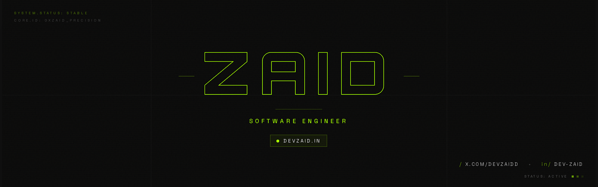

I'm Zaid, a backend engineer working in Go, TypeScript and Python. Based in Bangalore.

### Now

Doing agentic commerce research at **General Machines**.

- Built shop-harness in Python, an agent on a local 4B model (Ollama) that shops live Shopify stores through the Shopify UCP MCP, with 300+ traced runs across 7 stores
- Built checkout-sandbox, a Python service that charges Shopify carts in Stripe test mode using shared payment tokens capped at the approved total

### Before

- **DEnergy** (Jan 2025 - Sept 2026): built Go services for an Evmos-based L1, shipped to mainnet across 50+ nodes, and fixed a mainnet halt in our Cosmos SDK fork
- **Mable** (Aug 2023 - July 2024, intern): Postgres partitioning that cut query latency from ~2s to ~500ms, RBAC with Casbin, Redis-backed APIs

### Some things I've built

- [token-diet](https://github.com/dev-zaid/token-diet) - fewer tokens for shopping agents, same choices. A learning project in AI engineering
- [rpc-proxy](https://github.com/dev-zaid/rpc-proxy) - JSON-RPC proxy that serves `trace_block` from Blockscout's Postgres and forwards everything else to an Evmos node
- [Pyrex](https://github.com/dev-zaid/Pyrex-ETHGlobal25) - cross-border payments over PYUSD, with an orderbook and a routing agent that splits orders across sellers (ETHGlobal)
- **Trench** - wallet and token data platform, streaming 10M+ live records with Redis Pub/Sub and PostgreSQL

### Stack

- **Languages:** Go, TypeScript, Python, Solidity
- **Backend:** gRPC, NodeJS, PostgreSQL, Redis, Cosmos SDK
- **AI:** Claude, MCP, Ollama, tool calling
- **Infra:** AWS, Docker, Terraform, GitHub Actions, Linux

### Reach me

[devzaid.in](https://devzaid.in) · [LinkedIn](https://linkedin.com/in/dev-zaid) · [Email](mailto:mohdzaid2904@gmail.com)
