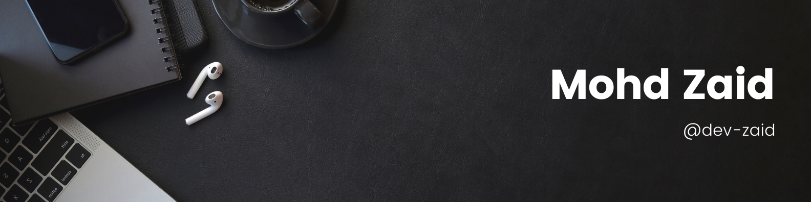
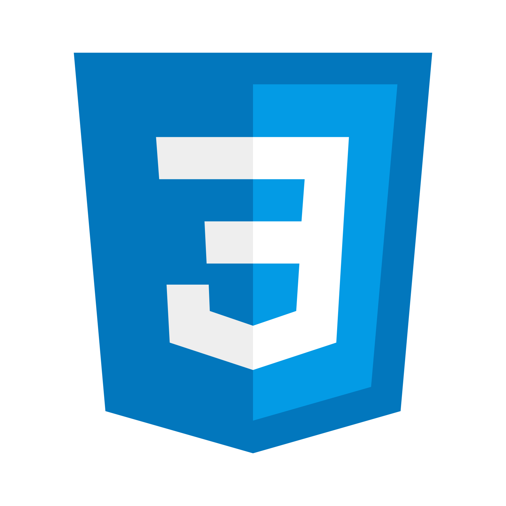
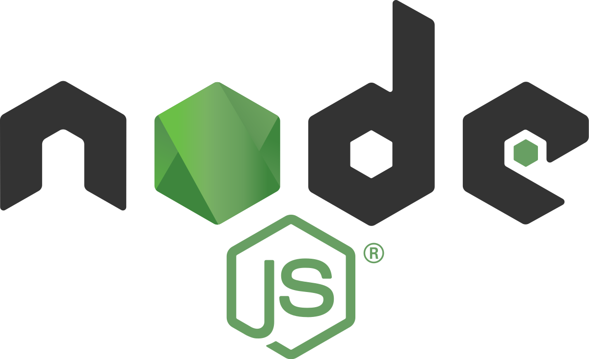
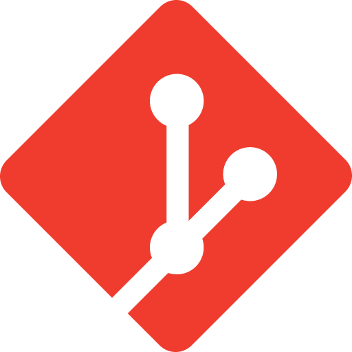
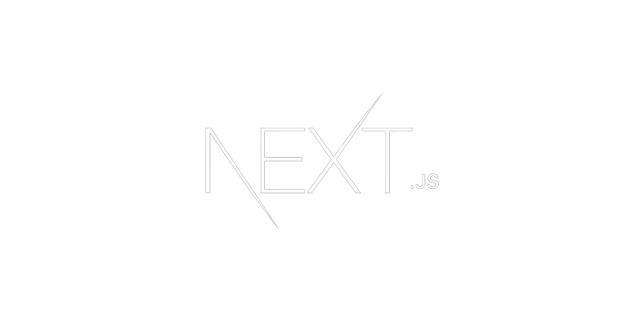
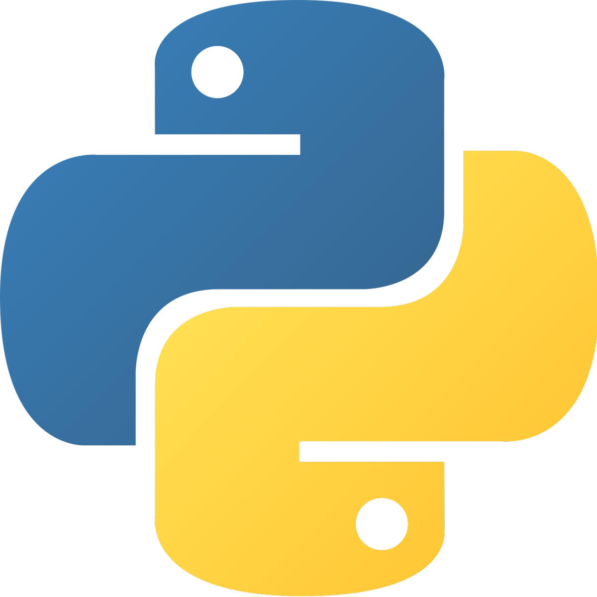
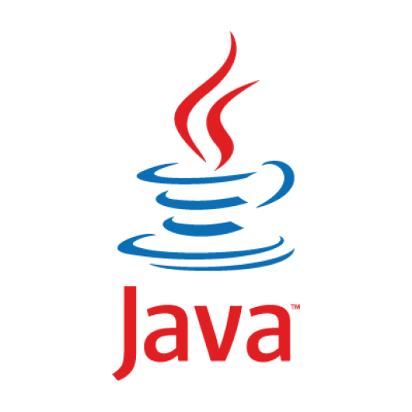
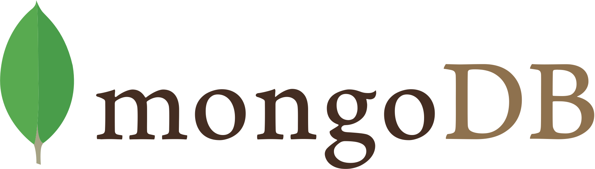

### About Me
I’m a Blockchain Developer and Software Engineer working on Layer-1 blockchain infrastructure and distributed systems.

Currently, I lead protocol development at DEnergy Networks, building an Evmos/Cosmos-SDK–based L1 with a native dual-staking consensus (NFT + token staking), validator infrastructure, and on-chain energy tracking for 100+ nodes.

I have 2+ years of experience building high-throughput backend systems and blockchain data pipelines, working with Go, TypeScript, Cosmos SDK, PostgreSQL, Redis, Docker, and AWS. I enjoy solving low-level protocol problems, optimizing systems at scale, and building infrastructure that runs in production.

### Languages and Skills
&nbsp;&nbsp;&nbsp;
<a href="#">

      &nbsp;&nbsp;&nbsp;

      &nbsp;&nbsp;&nbsp;

      &nbsp;&nbsp;&nbsp;

      &nbsp;&nbsp;&nbsp;

      &nbsp;&nbsp;&nbsp;

      &nbsp;&nbsp;&nbsp;

      &nbsp;&nbsp;&nbsp;

      &nbsp;&nbsp;&nbsp;

      &nbsp;&nbsp;&nbsp;

      &nbsp;&nbsp;&nbsp;
</a>

<h3>📫 Connect</h3>
</a>
&nbsp;&nbsp;&nbsp;&nbsp;&nbsp;&nbsp;&nbsp;&nbsp;
    <a href="https://www.instagram.com/zaid.js/" target="_blank">
    
    <a href="https://www.linkedin.com/in/mohd-zaid-17713221a/" target="_blank">
    &nbsp;&nbsp;&nbsp;&nbsp;&nbsp;&nbsp;
    
</a>
<!--
**zaidtab123/zaidtab123** is a ✨ _special_ ✨ repository because its `README.md` (this file) appears on your GitHub profile.

Here are some ideas to get you started:

- 🔭 I’m currently working on ...
- 🌱 I’m currently learning ...
- 👯 I’m looking to collaborate on ...
- 🤔 I’m looking for help with ...
- 💬 Ask me about ...
- 📫 How to reach me: ...
- 😄 Pronouns: ...
- ⚡ Fun fact: ...
-->
